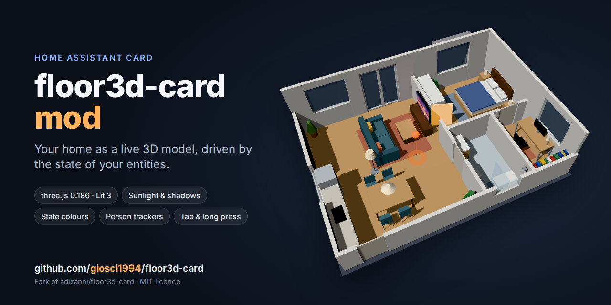
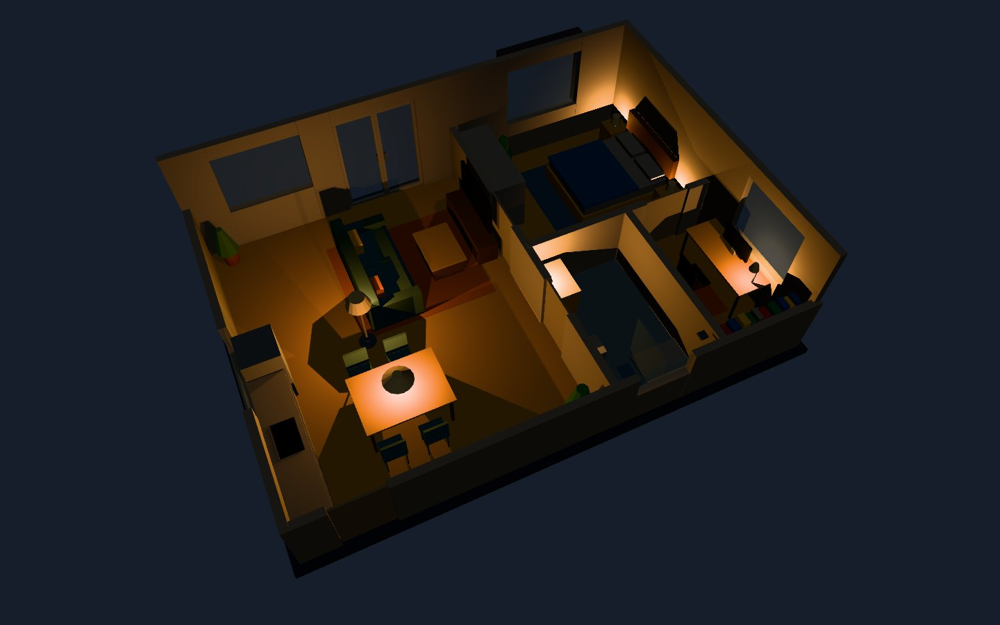
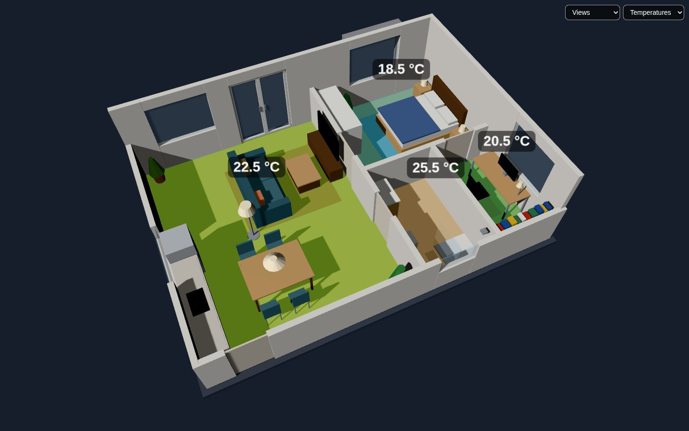
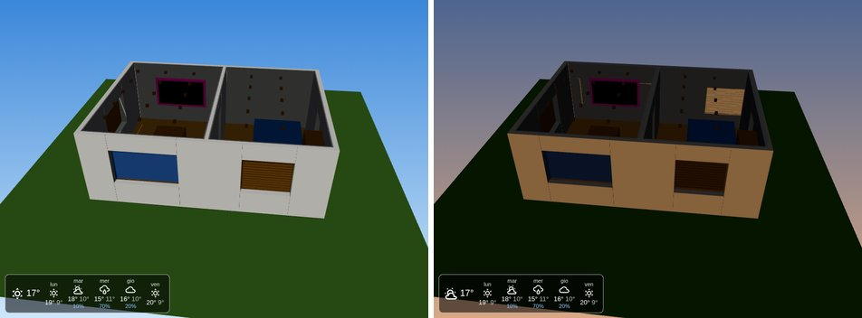
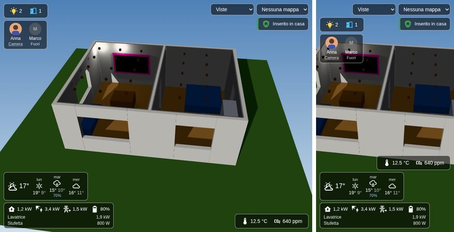
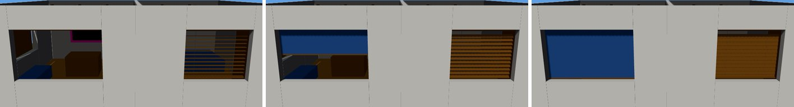
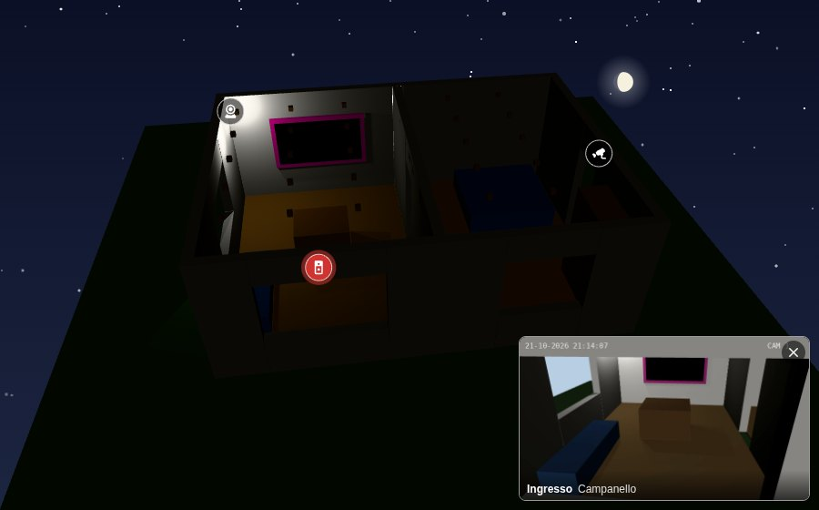

# floor3d-card mod

The 3D model of your home in a Home Assistant card, live: lamps that light the rooms with their colour and their shadows, doors and covers that open, rooms coloured by their sensors, alarms that blink, the sun, the sky and the weather, people, cameras and the energy of the house, all on the model.

**📖 Documentation: [giosci1994.github.io/floor3d-card](https://giosci1994.github.io/floor3d-card/)**: installation, the 3D model, the editor, every entity type and option, and troubleshooting.

> A fork of [adizanni/floor3d-card](https://github.com/adizanni/floor3d-card), with the same `custom:floor3d-card` and the same configuration: a card that worked with the original works with this one. The notes for developers, and the bugs of the original card fixed here, are in [FORK.md](FORK.md). If it is useful to you, you can support it on [Buy Me a Coffee](https://buymeacoffee.com/giosci1994u).

## New in 2.13

A cleaner and faster base for what comes next, with nothing to change in your configuration:

- **Lighter on large models.** A change of state, and every frame of an alarm, no longer search the objects through the whole model (thousands of objects in a model of Sweet Home 3D): each object is found once.
- **The code in modules.** The card was one file of 7,000 lines; now each part (the boxes, the cameras, the sky, the rooms and every type of entity) is a module of its own, with tests in the browser for each of them.
- **Updated libraries:** three.js 0.186, Lit 3, tween.js 25.
- **2.13.3:** a [photo frame](https://giosci1994.github.io/floor3d-card/entities/image/#a-photo-frame) on any object of the model (`image.attribute`), models whose level numbers skip one (thanks to [niltrip](https://github.com/niltrip)), and a [live demo](https://giosci1994.github.io/floor3d-card/) on the documentation site.

## What the card does

- **Models:** OBJ + MTL from Sweet Home 3D, or GLB, also compressed with Draco or meshopt (several times smaller); levels, with a menu to show them; a loading screen with its progress. See [GLB and compressed models](https://giosci1994.github.io/floor3d-card/model/glb/).
- **[Card editor](https://giosci1994.github.io/floor3d-card/editor/overview/):** settings in sections, lists of entities, object groups, views and rooms, objects picked with a tap in the preview, a pause while you edit. A card added from the card picker asks for the model and opens on it.
- **[Light and shadows](https://giosci1994.github.io/floor3d-card/features/light/):** lamps in the colour and brightness of the light entity, one light for a lamp of many objects, the sun of `sun.sun` with its shadows, sun and sky from sensors for cloudy days, and shadows kept within what the device can draw (the editor says which lights have them).
- **[Entities on the model](https://giosci1994.github.io/floor3d-card/entities/overview/) (`type3d`):** lights, colours (by state, or [as their light](https://giosci1994.github.io/floor3d-card/entities/color/#the-colour-of-a-light), for a LED strip), objects shown or hidden, [doors](https://giosci1994.github.io/floor3d-card/entities/door/) that swing or slide, [covers](https://giosci1994.github.io/floor3d-card/entities/cover/) that slide, roll up or turn their slats, [text on objects](https://giosci1994.github.io/floor3d-card/entities/text/), info boxes, objects that [turn](https://giosci1994.github.io/floor3d-card/entities/rotate/) with a fan or to the angle of a sensor, a [TV screen or a photo frame](https://giosci1994.github.io/floor3d-card/entities/image/) that lights the room with its picture, [person trackers](https://giosci1994.github.io/floor3d-card/entities/tracker/) from presence radars, a shower, [alarm](https://giosci1994.github.io/floor3d-card/entities/alarm/) and [heating](https://giosci1994.github.io/floor3d-card/entities/climate/) objects.
- **[Room maps](https://giosci1994.github.io/floor3d-card/features/rooms/):** rooms coloured by temperature, presence, illuminance, humidity, CO₂, PM2.5, VOC, power or any other sensor, with the value and a legend; open doors and windows in [colour](https://giosci1994.github.io/floor3d-card/features/rooms/#open-doors-and-windows), red with the alarm armed.
- **[Alarms](https://giosci1994.github.io/floor3d-card/features/alarms/) and [heating](https://giosci1994.github.io/floor3d-card/entities/climate/):** a room blinks with smoke, gas or a water leak and the camera goes there; radiators glow while they heat; a room shows the target of its thermostat.
- **[Sky and weather](https://giosci1994.github.io/floor3d-card/features/sky/):** a sky behind the house that follows the sun, with stars and the moon at night, a lawn under the house that opens over the basement, and the forecast in a corner.
- **[Walls](https://giosci1994.github.io/floor3d-card/features/walls/):** the walls in the way of the view fade as it turns, or every wall is cut low, as a doll's house.
- **[Boxes](https://giosci1994.github.io/floor3d-card/features/boxes/) in the corners:** what is on or open (a tap shows it in the model), energy, people, the alarm panel and any entity as a chip; they fold, and stay out of each other's way on a phone.
- **[Markers](https://giosci1994.github.io/floor3d-card/features/markers/):** any entity as a chip over the model, with its icon and its state, at a point or over an object; a tap opens it.
- **[Cameras](https://giosci1994.github.io/floor3d-card/features/cameras/):** an icon on the map where each camera is, and its picture popping up when the doorbell rings or it sees motion.
- **[Views](https://giosci1994.github.io/floor3d-card/features/views/):** zoom areas with their own camera and level, [views from the page address](https://giosci1994.github.io/floor3d-card/features/views/#views-from-the-page-address), [taps and long presses](https://giosci1994.github.io/floor3d-card/entities/overview/#taps) on the objects.
- **[Wall tablets](https://giosci1994.github.io/floor3d-card/features/wall-tablets/):** a kiosk mode without header and menus, with a tour of the views, and a lighter quality for weak tablets (by itself with `quality: auto`).
- **[Languages](https://giosci1994.github.io/floor3d-card/features/languages/):** English, Italian and German (the card also in Norwegian), in the language of each user.
- **Shorter configuration:** [object ids with `*`](https://giosci1994.github.io/floor3d-card/model/objects/#names-with-), [yes/no or true/false](https://giosci1994.github.io/floor3d-card/editor/yaml/), and many [bugs of the original card fixed](FORK.md#fixes).

|  |  |
| :---: | :---: |
| Lamps with their shadows | Rooms coloured by temperature |
|  |  |
| The sky and the weather | The boxes in the corners |
|  |  |
| Covers and blinds | Cameras on the map |

## Installation

### HACS

[](https://my.home-assistant.io/redirect/hacs_repository/?owner=giosci1994&repository=floor3d-card&category=plugin)

1. In HACS, search for **floor3d-card mod**: the card is in the default list of HACS. Or open the link above.
2. Open it and click **Download**. HACS adds the resource by itself.
3. Reload the browser or the app.

If the original floor3d-card is installed, remove it from HACS first: both define `custom:floor3d-card` and use the same `www/community/floor3d-card` folder. The configuration of the card stays the same: see [Coming from the original card](https://giosci1994.github.io/floor3d-card/getting-started/installation/#coming-from-the-original-card).

### By hand

Copy all the files (`.js` and `.wasm`) of the [latest release](https://github.com/giosci1994/floor3d-card/releases/latest) into a folder of `/config/www` and add `floor3d-card.js` as a resource (details in [Installation](https://giosci1994.github.io/floor3d-card/getting-started/installation/#by-hand)). It's **required** to load this card as `module`.

```yaml
- url: /local/floor3d-card/floor3d-card.js?v=2.13.3 # the version: change it at every update
  type: module
```

See Home Assistant documentation for adding custom cards (https://developers.home-assistant.io/docs/frontend/custom-ui/custom-card) and registering JavaScript resources (https://developers.home-assistant.io/docs/frontend/custom-ui/registering-resources).

## Getting started

1. Model your home, for example with [Sweet Home 3D](http://www.sweethome3d.com/), and export it as OBJ (or convert it to GLB): see [Modelling your home](https://giosci1994.github.io/floor3d-card/model/sweet-home-3d/).
2. Copy the files of the model into a folder of `/config/www`, for example `/config/www/floor3d/` (it is `/local/floor3d/` for the card).
3. In a dashboard, add the card **floor3d-card mod** from the card picker. The editor opens on the 3D model: set the folder and the file of the model.
4. Add the entities: for each one choose its type and pick its object with a tap on the model in the preview: see [The card editor](https://giosci1994.github.io/floor3d-card/editor/overview/) and [Entity types](https://giosci1994.github.io/floor3d-card/entities/overview/).

The video tutorials of the original card still show how a model is made and bound to the entities:

| Tutorial [](https://www.youtube.com/watch?v=ArBy7uqSJkY) | Your First Card [](https://youtu.be/4qrDpDnPK6I) |
| --- | --- |

## Credits

The original card is by [adizanni](https://github.com/adizanni), and so are much of the documentation, which comes from its README, and the [ExportToHASS](https://github.com/adizanni/ExportToHASS) plugin for Sweet Home 3D. You can support the original card on [Buy Me a Coffee](https://buymeacoffee.com/AndyHA).
